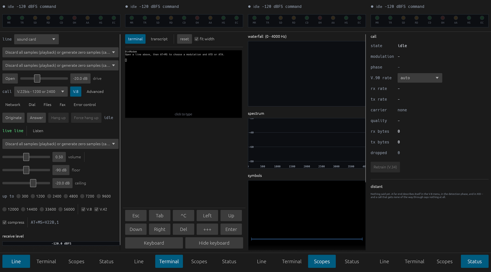

# BinModemAPK
This is not official.

An Android build of [BinModem](https://github.com/CasualArclamp/BinModem), the
dial-up softmodem in Rust. The upstream source is the `BinModem/` submodule and
is not modified; `android/` borrows its GUI modules unchanged and adds an
Android entry point.

## What the Android build adds

A layout for a phone held upright (`android/src/mobile.rs`), built from the
desktop window's own controls:

- **Line**: the line, the call and every setting, wrapped into one column.
  Dial, Network, Advanced, Files, Fax and Error control open as full-screen
  sheets with a close button.
- **Terminal**: the terminal sized to fit 80 columns across (untick *fit
  width* for a font slider), with Esc, Tab, Ctrl-C, the arrows, Del, `+++`
  and Enter as buttons, since a phone keyboard has none of them. Tapping the
  terminal raises the keyboard.
- **Scopes**: waterfall, spectrum and constellation, stacked.
- **Status**: the call's state and rates, the V.90 rate menu, Retrain, and
  what the far end said about itself.
- A strip along the top with the call state and the modem's lights, always in
  view, and a **Sound** toggle (lit while on, like V.8). On, you hear the
  call and the monitor opens by itself; off is silence: it closes the
  monitor, and on a sound-card line silences the modem's own tones too, so
  there the far end hears nothing from this side while it is off. A SIP call
  carries on as normal either way.
- **Caller** and **Answerer** toggles in place of Listen (on the Line tab, and
  above the waterfall on Scopes): each side of the call on or off, both for
  what you hear and for what the spectrum and waterfall draw. Which one is
  your modem follows who dialled, and is marked "(you)" during a call. Over
  SIP your own side is mixed into what you hear at about the far end's level;
  on a sound-card line it is already coming out of the phone, so only the
  spectrum follows that switch. All three switches are remembered between runs.

Also: settings and SIP accounts kept in the app's private storage, and the
microphone permission asked for on first launch.

### The modem: upstream 5.5.0, unpatched

The submodule is at upstream 5.5.0 (`69dd399`): V.92
with PCM upstream (the **V.92** entry in the mode box, `AT+MS=V92`), quick
connect, V.8 bis, HST, x2, and the rest of upstream's modulations. The Android
build applies no patches to it. On the phone:

- **Status** shows upstream's call card, with the PCM down and PCM up rate
  menus.
- **Terminal** has upstream's tabs beside the terminal: transcript, **fax**
  (laid out in one column) and **review** (upstream's reader for recordings
  of calls). Review's Open is a file dialog, which Android lacks, so the
  recordings Record has made are listed above it to open with a tap.
- The faceplate's Scopes and Fax keys go to the Scopes page and the fax tab.
- The layout keeps clear of the status and navigation bars and of the
  keyboard (Android's content rectangle). With the keyboard up, the tabs and
  lamps step aside and the extra keys fit in one row, so the terminal stays
  in view.
- The faceplate is upstream's readout across the width: the desktop puts the
  lamps beside it, which does not fit a phone, and the lamps are in the strip
  at the top here anyway.
- The tabs have icons.
- Upstream's line controls also start fax calls, take received pages and
  show the incoming-call prompt. Only the Line page draws them, so on the
  other pages they run unseen; otherwise Send fax on the fax tab did nothing.

`android/patches/long-dil.patch` (read the DIL twice) still applies but is not
applied by `build-apk.sh`.

### x2 dialling out (`android/patches/x2-dialout.patch`)

Upstream serves U.S. Robotics x2 but cannot dial out with it. This build
adds the calling side: **x2** in the mode box, or `AT+MS=X2`.

- **Calling:** V.34's call modem through phase 2. If the server offers x2 in
  its INFO0a, the client sends x2's marker after the server's probe and takes
  the call from phase 3: 32000 down to start with, then 56000 once the line
  has been clean for two seconds, and V.34 up. If the server doesn't offer
  x2, the call simply carries on as V.34.
- **Answering:** `AT+MS=X2` is an x2 server, whatever S70 says.
- **SIP only:** the client reads the server's G.711 octets as octets, so it
  needs a SIP line in PCMU. Over a sound card it will not reach data mode,
  and says so in the Line notes.
- **Lost packets:** the client finds the server's frames by the alignment
  pattern, not by counting octets, and finds them again when a lost or
  repeated packet moves them. A downstream that keeps losing frames asks for
  a lower rate.

Fixes to upstream's code that this needed:
- the simulated x2 client's upstream encoder takes a whole mapping frame of
  bits at once, so it now asks for two frames' worth to be queued; with 64,
  ones went into the middle of every frame and V.42 never came up;
- the x2 server waits for the client's marker 800 ms after its L1 *plus the
  round trip*, which on a SIP call (two jitter buffers) can be 700 ms.

Tested only in simulation: against upstream's x2 server (written from the
same facts), in the datapump, as two modems wired together, and as two modems
over SIP media on one machine with packets lost on the way down
(`crates/modem/tests/x2_sip.rs`). It has not met a U.S. Robotics or 3Com x2
server.

### How it is put together

Upstream is not edited. `android/build.rs` copies the GUI files that need it
into the build directory and swaps four things in the copy: wrapping rows for ones held to the screen,
with text that does not fit shortened with "..." (in egui, one overflowing
row -- a SIP address, which has nowhere to break -- shifts or widens every
row after it), combo boxes and sliders for versions that move to a new row when
they do not fit (egui cannot wrap them otherwise), and windows for
full-screen sheets.
In `app.rs` the Listen button becomes the Caller/Answerer switches; in
`live.rs` the sound-card output, the monitor and the spectrum go through the
switches (mixing our own side in where it is on), and fails the build if those lines change upstream. It
also adds `mod mobile;` inside `app`, which is how the phone layout reaches
the window's private state.

To look at the layout without a phone (Linux, needs ALSA and X11):

    cd android && BINMODEM_PAGE=terminal cargo run --example preview

`BINMODEM_PAGE` is `line`, `terminal`, `scopes` or `status`;
`BINMODEM_INSETS=0,330` draws as if the keyboard were up;
`BINMODEM_OPEN=dial|network|advanced|files|fax|error` opens a window too
(and `v90`, `sip` pick those, `long` draws a SIP call's long status row; several can be given, comma-separated).

## Limits

- `Browse` opens Android's own file picker, so a document can come from
  Google Photos, Drive, Downloads or any other app that offers files. The
  chosen file is copied to `Android/data/io.github.binmodem/files/picked`.
  This is `android/java/.../MainActivity.java`: the NativeActivity with the
  picker added, compiled by `build-apk.sh`. Choosing a folder (ZMODEM's
  receive folder) uses the app's own file browser. Fax `Save` needs no
  dialog: files go to `files/saved`.
- arm64-v8a only, Android 8.0 (API 26) or newer (AAudio).

## Building

    git clone --recursive https://github.com/ooper1234/BinModemAPK
    cd BinModemAPK
    ANDROID_HOME=~/Android/Sdk ./build-apk.sh    # -> BinModem.apk

Needs Rust, a JDK, and an Android SDK with build-tools, a platform and the NDK.
Without `KEYSTORE`/`KEYSTORE_PASS`/`KEY_ALIAS` set, a debug key is generated in
`android/debug.keystore`.

Every push also builds the APK in GitHub Actions (`Build APK` workflow); download
it from the run's artifacts.

## License

GPL-3.0-or-later, as upstream.
