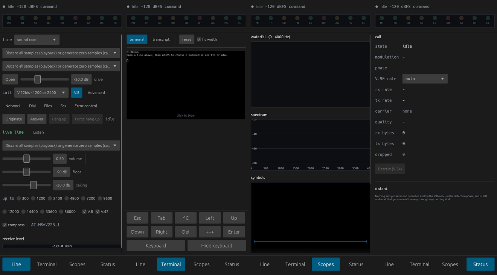

# BinModemAPK
This is not official.

An Android build of [BinModem](https://github.com/CasualArclamp/BinModem), the
dial-up softmodem in Rust. The upstream source is the `BinModem/` submodule and
is not modified; `android/` borrows its GUI modules unchanged and adds an
Android entry point.

## What the Android build adds

A layout for a phone held upright (`android/src/mobile.rs`), built from the
desktop window's own controls:

- **Line**: the line, the call and every setting, wrapped into one column.
  Dial, Network, Advanced, Files, Fax and Error control open as full-screen
  sheets with a close button.
- **Terminal**: the terminal sized to fit 80 columns across (untick *fit
  width* for a font slider), with Esc, Tab, Ctrl-C, the arrows, Del, `+++`
  and Enter as buttons, since a phone keyboard has none of them. Tapping the
  terminal raises the keyboard.
- **Scopes**: waterfall, spectrum and constellation, stacked.
- **Status**: the call's state and rates, the V.90 rate menu, Retrain, and
  what the far end said about itself.
- A strip along the top with the call state and the modem's lights, always in view.

Also: settings and SIP accounts kept in the app's private storage, and the
microphone permission asked for on first launch.

### How it is put together

Upstream is not edited. `android/build.rs` copies the GUI files that need it
into the build directory and swaps three things in the copy: combo boxes and
sliders for versions that move to a new row when they do not fit
(egui cannot wrap them otherwise), and windows for full-screen sheets. It
also adds `mod mobile;` inside `app`, which is how the phone layout reaches
the window's private state.

To look at the layout without a phone (Linux, needs ALSA and X11):

    cd android && BINMODEM_PAGE=terminal cargo run --example preview

`BINMODEM_PAGE` is `line`, `terminal`, `scopes` or `status`;
`BINMODEM_OPEN=dial|network|advanced|files|fax|error` opens a window too.

## Limits

- File dialogs (`Browse…` for ZMODEM and fax pictures) are stubbed out; type a
  path into the box beside them instead (e.g. under `/sdcard/Download`,
  which may need the app's storage access granted in Android settings).
- arm64-v8a only, Android 8.0 (API 26) or newer (AAudio).

## Building

    git clone --recursive https://github.com/ooper1234/BinModemAPK
    cd BinModemAPK
    ANDROID_HOME=~/Android/Sdk ./build-apk.sh    # -> BinModem.apk

Needs Rust, a JDK, and an Android SDK with build-tools, a platform and the NDK.
Without `KEYSTORE`/`KEYSTORE_PASS`/`KEY_ALIAS` set, a debug key is generated in
`android/debug.keystore`.

Every push also builds the APK in GitHub Actions (`Build APK` workflow); download
it from the run's artifacts.

## License

GPL-3.0-or-later, as upstream.
